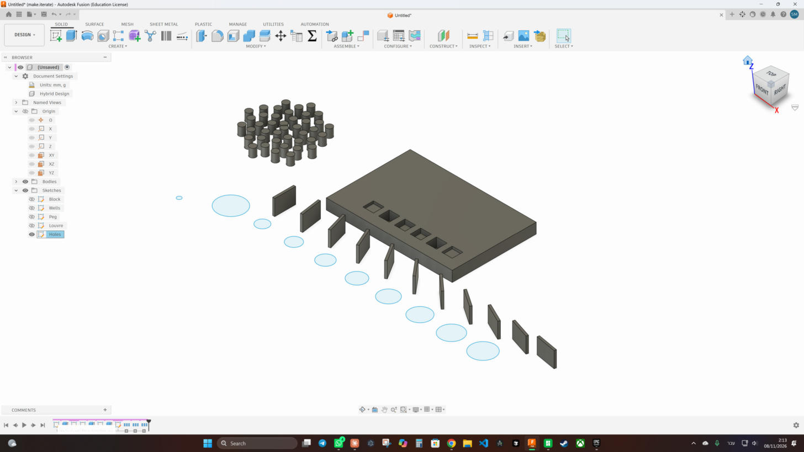

# Formula Pattern for Fusion 360

A Fusion 360 add-in that patterns objects **along a direction or around an
axis where a formula decides the distance (or angle) of every copy**.
Guitar fret slots, louvres that get denser toward one end, ports that grow
geometrically, rings whose angular step eases in and out: pick a preset or
type the rule yourself, watch the numbers and the model update live, press OK.

The result is ordinary Fusion geometry: one native pattern feature per copy,
collected in a timeline group, with every distance left as an editable
parameter. Faces, bodies, features (cuts included) and components all work,
exactly like the built-in Rectangular / Circular Pattern. Inside a sketch
it patterns sketch curves with native sketch pattern constraints instead.

## Install

**Windows**

```powershell
.\install.ps1
```

**macOS**

```bash
./install.sh
```

Both link the `FormulaPattern` folder into Fusion's AddIns folder (add
`-Copy` / `--copy` to copy instead). Then in Fusion:
**UTILITIES → ADD-INS → Add-Ins tab → FormulaPattern → Run**, and tick
*Run on Startup*. The **Formula Pattern** button appears in **SOLID → CREATE**
(next to Rectangular Pattern) and, while a sketch is open, in
**SKETCH → CREATE** (next to the sketch patterns).

After editing the add-in's code, **Stop** and **Run** it again in that
dialog; the add-in drops its cached modules on Stop so the new code loads
without restarting Fusion.

Manual install: copy the `FormulaPattern` folder to

* Windows: `%APPDATA%\Autodesk\Autodesk Fusion 360\API\AddIns\`
* macOS: `~/Library/Application Support/Autodesk/Autodesk Fusion 360/API/AddIns/`

## Using it

1. **Pattern type**: Linear (copies along a direction), Circular (copies
   around an axis) or Path (two formulas give every copy's X / Y or
   radius / angle offset in a plane: spirals, waves, grids).
2. **Object type** and **Objects**: Bodies, Features, Faces, Components,
   Sketch curves or Profiles, then click what to pattern. Changing the type
   clears the selection and switches what can be clicked.
3. **Direction** (a linear edge, sketch line or construction axis) or **Axis**
   (also circular edges and cylindrical faces); a Path takes two directions.
   **Flip direction** sends the copies the other way.
4. **Copies**: how many new copies. The original stays and is copy 0; the
   formula runs for `i = 1 … Copies`.
5. **Formula**: pick a **Preset** or write your own. **Formula gives** chooses
   what the formula means:
   * *Distance from original* (or *Angle from original*): the formula is
     where copy `i` sits, measured from the original.
   * *Gap to previous* (or *Angle step from previous*): the formula is the
     step from copy `i-1` to copy `i`; the positions add up.
6. **a, b, c** are values you can use inside the formula. `a` carries units
   (a length for linear, an angle for circular), so `25.5 in` works; `b` and
   `c` are plain numbers.
7. **Vary each copy** (collapsed): more formulas, one per copy. **Rotation**
   turns every copy by its own angle about an axis; **Size** scales it, or
   sets a sketch circle's diameter; **Depth** (with *Object type: Profiles*)
   extrudes the profile by its own depth per copy and can join or cut the
   result into a target body. These work with bodies, components, sketch
   curves and profiles.
8. The **Preview** box lists every copy's position (and gap, turn, size and
   depth) as you type; the model updates too while *Show in model* is on.
   Errors say which copy failed and why, and OK stays disabled until the
   formula is good.

Example, fret slots for a 25.5" scale: model the slot as a cut at the nut,
choose *Object type: Features*, click the slot cut, click an edge running
along the neck, set *Copies* to 22, pick the **Guitar frets (12-TET)** preset
and set `a` to `25.5 in`. The preview shows fret 12 at exactly half the
scale. OK.

### In a sketch

Open the command while editing a sketch (SKETCH → CREATE → Formula
Pattern) and *Object type* is already **Sketch curves**:

* **Objects**: the sketch curves and points to pattern (all from the same sketch).
* **Direction**: a sketch line, or leave it empty to pattern along the
  sketch's X axis. **Axis** (circular): a sketch point, or a circle to use
  its centre.
* The copies are native sketch pattern constraints, one per copy, so they
  follow the original curves when you change them, and each copy's distance
  stays an editable dimension. There is no timeline group: sketch
  patterns live inside the sketch.

The same fret example works in 2D: draw one fret slot line, a construction
line down the neck, and pattern the slot along it.

### Presets

| Preset | Formula gives | Formula | Tunables |
|---|---|---|---|
| Constant spacing | gap | `a` | a = gap |
| Guitar frets (12-TET) | distance | `a * (1 - 1 / 2^(i / 12))` | a = scale length |
| Growing gaps (geometric) | gap | `a * b^(i - 1)` | a = first gap, b = growth factor |
| Growing gaps (arithmetic) | gap | `a + b * (i - 1)` | a = first gap, b = increase per gap |
| Ease in & out (sine) | distance | `a * (1 - cos(pi * t)) / 2` | a = total extent |
| Ease in (power) | distance | `a * t^b` | a = total extent, b = curve |
| Fibonacci gaps | gap | `a * fib(i)` | a = first gap |
| Golden angle (circular only) | angle step | `a` | a = 137.508° |

Path presets (two formulas): Archimedean spiral, Logarithmic spiral,
Sunflower (phyllotaxis), Sine wave, Ellipse, Grid (b per row).

Editing the formula or the mode turns the preset into *Custom*; the values
you typed are kept.

### Writing a formula

| Name | Meaning |
|---|---|
| `i` | copy number, 1 … n |
| `n` | number of copies |
| `t` | `i / n`, runs 0 → 1 (handy for easing) |
| `a`, `b`, `c` | the three values in the dialog |
| any user parameter | by name, in document units (angles in degrees) |

Operators `+ - * / ^ %` (`^` is power), comparisons, and `x if cond else y`.

Functions: `sin cos tan asin acos atan atan2` (radians), `sind cosd tand`
(degrees), `rad deg`, `sqrt cbrt exp pow`, `ln log(x, base) log2 log10`,
`abs floor ceil round trunc`, `min max clamp(x, lo, hi) sign hypot`,
`fib(i)`. Constants `pi e tau phi`.

Results are in the document's length unit (linear) or degrees (circular).
Angles are reduced modulo 360. A copy that lands on the original is an
error that names the copy; two copies on the same spot are a warning.

### What you get in the timeline

A group named *Formula Pattern* (rename it under *Advanced*) holding one
pattern feature per copy, named `Formula Pattern 3/12` and so on. Each one
is a normal Fusion pattern with quantity 2 and the computed extent, so you
can edit, suppress or delete individual copies afterwards. The settings used
are stored as attributes on the features (`FormulaPattern/settings`).

Path patterns, patterns with Rotation or Size, and Profiles patterns are
built from native Copy, Scale, Move, Extrude and Combine features instead
(one new occurrence per copy for components), in the same kind of group.



The last-used values (not selections) are remembered in
`~/.fusion_formula_pattern.json`.

### Editing a pattern you made earlier

Run Formula Pattern and pick the pattern from the **Saved pattern** list at
the top of the dialog; it lists every pattern in the design by group name
and number of copies. Its copies light up in the model and the timeline, the
dialog loads its objects, direction, formula, values and count, and a line
under the list says what OK will do. Change anything and press OK to replace
the pattern in place; OK with nothing changed leaves it alone. *New pattern*
in the list makes a new one from the loaded values instead.

## Tips and limits

* Big patterns: the model preview switches itself off above 100 copies
  (the numeric preview stays live); the result is built when you press OK.
* Replacing a pattern breaks later features that referenced faces of the
  old copies, as deleting the group would; re-select them afterwards.
* Linear and circular patterns have one direction; for a grid use a Path
  pattern with the *Grid* preset.
* Rotation and Size need bodies, components, sketch curves or profiles;
  faces and features keep to plain positions.
* Construction geometry cannot be patterned, same as the native command.
  Sketch curves use *Object type: Sketch curves* (see above).
* Patterning features across components follows the native rules: the
  features are created in the active component.

## Documentation

* [User guide](docs/user-guide.md): installing, every field of the dialog,
  walkthroughs (fret slots in a sketch and as a cut, louvres, phyllotaxis),
  the formula language, what the result looks like, and every message the
  add-in can show.
* [Development guide](docs/development.md): how the code is organised, how
  the tests drive the add-in without Fusion, how to add a preset, and the
  Fusion API behaviours the add-in works around.
* [Design document](docs/superpowers/specs/2026-11-06-formula-pattern-design.md):
  the decisions behind the design.
* [Changelog](CHANGELOG.md).

## Development

Pure-Python logic lives in `FormulaPattern/engine.py` (formula parser and
evaluator, positions, presets, preview text). The Fusion-facing dialog,
feature creation and sketch constraints live in `FormulaPattern/command.py`.
The tests run without Fusion: a small fake of the `adsk` API lives in
`tests/fake_adsk`.

```bash
python -m unittest discover -s tests -v
```

## License

[MIT](LICENSE).
