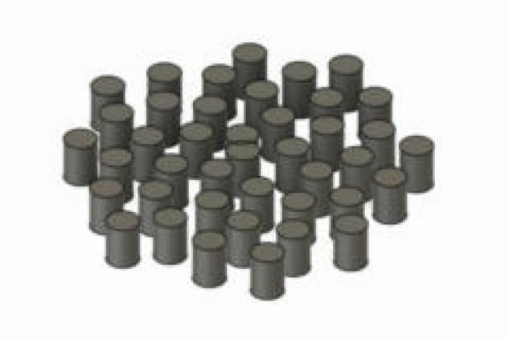
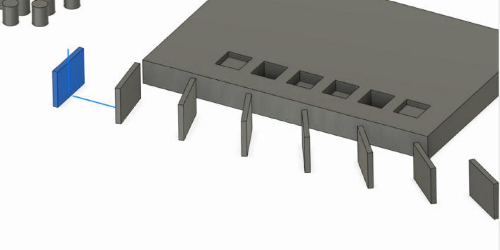
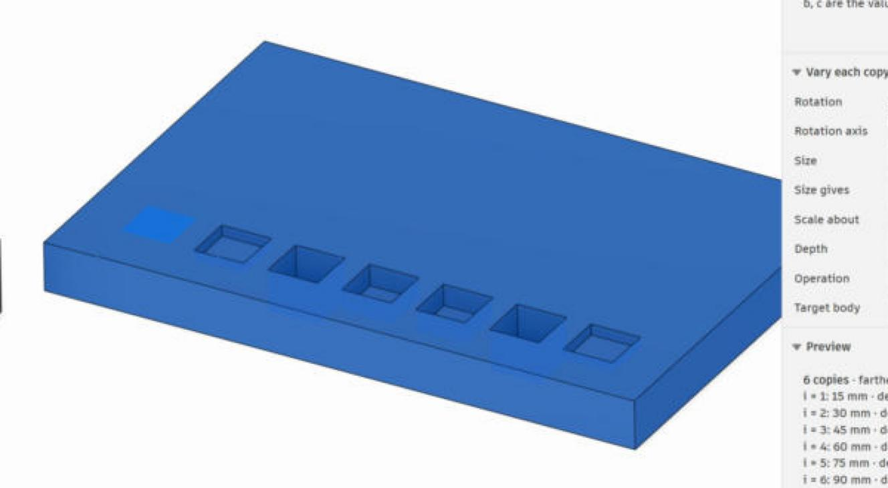

# Formula Pattern — User guide

Formula Pattern is a Fusion 360 add-in that works like the native
Rectangular / Circular Pattern, except that **a formula decides where every
copy goes**. Guitar fret slots, louvres that get denser toward one end, holes
whose spacing grows geometrically, rings whose angular step eases in and out:
pick a preset or write the rule yourself, watch the numbers and the model
update live, press OK. Since 1.2 a *Path* pattern takes two formulas for
a layout in a plane (spirals, waves, grids), and more formulas can turn,
scale or extrude every copy by its own amount.

It works on bodies, faces, features (cuts included), components and sketch
profiles, and on sketch curves while you edit a sketch.

Contents

1. [Installing](#1-installing)
2. [The dialog](#2-the-dialog)
3. [Walkthroughs](#3-walkthroughs)
4. [Presets](#4-presets)
5. [Writing a formula](#5-writing-a-formula)
6. [What you get](#6-what-you-get)
7. [Remembered settings](#7-remembered-settings)
8. [Messages and troubleshooting](#8-messages-and-troubleshooting)
9. [Limits](#9-limits)

---

## 1. Installing

**Windows**: open PowerShell in the project folder and run

```powershell
.\install.ps1
```

**macOS**: open Terminal in the project folder and run

```bash
./install.sh
```

Both link the `FormulaPattern` folder into Fusion's AddIns folder, so edits
to the source are picked up without reinstalling. Add `-Copy` (Windows) or
`--copy` (macOS) to copy the folder instead.

Manual install: copy the `FormulaPattern` folder to

* Windows: `%APPDATA%\Autodesk\Autodesk Fusion 360\API\AddIns\`
* macOS: `~/Library/Application Support/Autodesk/Autodesk Fusion 360/API/AddIns/`

Then, in Fusion: **UTILITIES → ADD-INS**, open the **Add-Ins** tab, select
**FormulaPattern**, click **Run** and tick **Run on Startup**.

The **Formula Pattern** button appears in two places:

* **SOLID → CREATE**, next to Rectangular Pattern.
* **SKETCH → CREATE**, next to the sketch patterns, while a sketch is open.

It is also reachable from the command search (press `S` and type
"Formula").

**Updating**: after replacing the add-in's files, select it in the Add-Ins
dialog, click **Stop**, then **Run**. The add-in clears its cached modules on
Stop, so no Fusion restart is needed.

---

## 2. The dialog

| Field | What it does |
|---|---|
| **Pattern type** | *Linear*: copies along a direction. *Circular*: copies around an axis. *Path*: two formulas give every copy's offset in a plane, as X / Y or as radius / angle (spirals, waves, sunflower layouts, grids). |
| **Object type** | Bodies, Features, Faces, Components, Sketch curves or Profiles. All selected objects must be of this kind. Changing it clears the selection and switches what can be clicked. *Profiles* are sketch profiles: every copy is the profile extruded by its own **Depth** (see *Vary each copy*). |
| **Objects** | Click what to pattern. |
| **Direction** (linear) | A linear edge, sketch line or construction axis. In a sketch: a sketch line, or leave it empty to pattern along the sketch's X axis. |
| **Direction**, **Direction 2 (Y)** (path) | The two directions that span the plane of the path: *Direction* is X, *Direction 2* is Y and is made perpendicular to it. In a sketch the path uses the sketch's X and Y axes, or the chosen line and its in-plane perpendicular, so only *Direction* is offered. |
| **Axis** (circular) | A linear edge, construction axis, sketch line, circular edge, sketch circle, or a cylindrical / conical / toroidal face. In a sketch: a sketch point, or a circle to use its centre. |
| **Flip direction** | Mirrors the pattern to the other side of the original (negative distances / angles). |
| **Copies** | How many *new* copies, 1 … 1000. The original stays where it is and is copy 0; the formula runs for `i = 1 … Copies`. |
| **Preset** | Ready-made formulas (see [Presets](#4-presets)). Picking one fills in the formula, the mode and `a b c`. Editing any of them switches the preset to *Custom* without losing your values. |
| **Formula gives** | *Distance from original* (or *Angle from original*): the formula is where copy `i` sits, measured from the original. *Gap to previous* (or *Angle step from previous*): the formula is the step from copy `i-1` to copy `i`; the positions add up. |
| **Formula** | The rule. See [Writing a formula](#5-writing-a-formula). |
| **Coordinates** (path) | *X / Y*: the two formulas are offsets along Direction and Direction 2. *Radius / Angle*: the first formula is the distance from the original, the second the angle in degrees, measured from Direction. |
| **Formula**, **Second formula** (path) | The two rules: X and Y, or radius and angle; the note under them says which. Both see the same `i n t a b c`. |
| **a** | A value for the formula with units: a length for linear and path patterns, an angle for circular ones. Expressions and units work, e.g. `25.5 in` or `scale / 2`. |
| **b, c** | Plain numbers for the formula. |
| **Vary each copy** (collapsed group) | Formulas that change every copy on top of its position. An empty field means "no change". These need bodies, components, sketch curves or profiles; faces and features cannot be rotated or scaled one by one. |
| **Rotation**, **Rotation axis** | Degrees to turn copy `i` about the axis (a linear edge, construction axis or sketch line) before it moves into place, so copies spin about the *original's* axis. In a sketch the field takes a sketch point to turn about; left empty, the copies turn about the centre of the selected curves. Example `b * i`. |
| **Size**, **Size gives**, **Scale about** | *Scale factor*: copy `i` is scaled by the formula (1 = unchanged) about the chosen point (a vertex, sketch point or construction point). *Diameter (circles)*: for sketch circles, the formula is the copy's diameter in document units. Not available for components. |
| **Depth**, **Operation**, **Target body** (profiles) | Each copy is the profile extruded by the formula's depth in document units. With *Cut* a positive depth goes into the target body, with *Join* away from it, with *New body* along the sketch's normal; a negative depth goes the other way. *New body* keeps the copies as separate bodies; *Join* / *Cut* merge them into, or cut them out of, the target body with one Combine feature. |
| **Preview** | Every copy's position (and gap), the farthest copy, and any warnings or errors. Updates as you type. Closed by default; opens by itself when there is an error to show. |
| **Show in model** | Builds the copies while the dialog is open. Switches itself off above 100 copies; the result is still built when you press OK. |
| **Saved pattern** (in *Edit a saved pattern*, at the top) | A list of every pattern made by Formula Pattern in this design. Pick one to load it and highlight its copies; OK then replaces that pattern. *New pattern* makes a new one. See [Editing a saved pattern](#editing-a-saved-pattern). |
| **Copies** | Appears once a pattern is picked: its copies, highlighted in the model and the timeline. Clicking any copy of another Formula Pattern here switches to that pattern. |
| **Formula reference** | A cheat sheet of the variables, functions and constants (collapsed). |
| **Advanced** | *Compute*: the same Optimized / Identical / Adjust choice as the native pattern. *Timeline group*: the name of the group that holds the copies. Hidden for sketch curves. |

OK stays disabled while something is missing or the formula has an error.

---

## 3. Walkthroughs

### 3.1 Fret slots in a sketch

1. Edit the sketch that holds the fretboard outline. Draw **one fret slot**
   as a line at the nut (or a thin rectangle, if the slots have width), and a
   **construction line** running down the neck in the direction of the frets.
2. **SKETCH → CREATE → Formula Pattern**. *Object type* is already
   **Sketch curves**.
3. **Objects**: click the slot line(s). **Direction**: click the construction
   line.
4. **Copies**: the number of frets, e.g. `22`.
5. **Preset**: **Guitar frets (12-TET)**. Set **a** to the scale length, e.g.
   `25.5 in` or `648 mm`.
6. Check the preview: copy 12 sits at exactly half of `a`. Tick **Flip
   direction** if the frets run the wrong way. **OK**.

Each fret is a native sketch pattern constraint, so editing the slot at the
nut updates every fret, and each fret's distance is an editable dimension.

### 3.2 Fret slots as a cut

1. Model the first slot as a cut (an extruded profile) at the nut.
2. **SOLID → CREATE → Formula Pattern**. *Object type*: **Features**, click
   the slot cut. *Direction*: an edge running along the neck, or a sketch
   line / construction axis.
3. As above: *Copies* `22`, preset **Guitar frets (12-TET)**, `a` = scale
   length. **OK**.

The timeline gets a group *Formula Pattern* with one pattern feature per
fret.

### 3.3 Louvres that get denser toward one end

Pattern a slot feature or a body with the **Growing gaps (geometric)** preset:
*Formula gives* = *Gap to previous*, formula `a * b^(i - 1)`, `a` = the first
gap, `b` = the growth factor. `b = 0.9` makes each gap 10 % smaller than the
one before; `b = 1.1` makes them grow.

### 3.4 Holes in a phyllotaxis spiral

Pattern type **Circular**, click a hole feature and the axis of the disc,
preset **Golden angle (phyllotaxis)**: every copy is rotated 137.508° further
than the previous one. Combine with a radial pattern of the result for a
sunflower-style layout.

### 3.5 Driving a formula from a user parameter

Any user parameter of the design (MODIFY → Change Parameters) can be used by
name. With a parameter `scale = 648 mm`:

```
scale * (1 - 1 / 2^(i / 12))
```

Lengths arrive in the document's units, angles in degrees, unitless
parameters as plain numbers. The pattern does not update automatically when
the parameter changes; run the command again.

### 3.6 A sunflower of pegs (path pattern)

1. Model one peg (a small cylinder) where the centre of the layout should
   be. **SOLID → CREATE → Formula Pattern**, *Pattern type* **Path**,
   *Object type* **Bodies**, click the peg.
2. **Direction** and **Direction 2 (Y)**: two edges of the base plate,
   or the X and Y axes under *Origin* in the browser.
3. *Copies* `60`, preset **Sunflower (phyllotaxis)**: radius `a * sqrt(i)`,
   angle `i * 137.508`. `a` sets how far apart the pegs end up.
4. The preview lists every copy as `(x, y)`; the model shows the spiral.
   **OK**.

Each copy is a native *Copy* and *Move* feature in one timeline group.
Swap the preset for **Sine wave**, **Ellipse** or **Grid (b per row)**, or
write two formulas of your own.



### 3.7 Test holes that grow (diameter)

In a sketch, draw one circle. **Formula Pattern**: *Object type* **Sketch
curves**, click the circle (a window selection that also takes its centre
point is fine), *Copies* `10`, formula `a * i` with `a = 8 mm`.
Open **Vary each copy**, type `a + 0.1 * i` into **Size** and choose
**Diameter (circles)**. Every copy is a circle 0.1 mm wider than the one
before, in a row 8 mm apart: extrude them all as a cut for a tolerance
test, or as pins. **Scale factor** does the same for any sketch curves,
with a factor instead of a diameter.

### 3.8 Louvres that twist (rotation)

Model one louvre standing on the origin. *Pattern type* **Linear**,
**Bodies**, click the louvre, *Direction*: the X axis, *Copies* `12`,
formula `a * i`. Under **Vary each copy** set **Rotation** to `b * i` and
**Rotation axis** to the Z axis (which runs through the louvre). With
`b = 7.5` each copy is turned 7.5° more than the last. The rotation is
about the original's axis, before the copy moves into place, so every
louvre turns about its own centre.



### 3.9 A QRD diffuser (profiles and depth)

1. Sketch one well (a rectangle) on the top face of a block.
2. **Formula Pattern**, *Object type* **Profiles**, click the rectangle's
   profile, *Direction*: an edge of the block, *Copies* `6`, formula
   `a * i` with `a` = the well pitch.
3. **Vary each copy**: **Depth** `a * ((i * i) % 7) / 7` (the quadratic
   residue sequence for N = 7; the original is well 0), **Operation**
   **Cut**, **Target body**: the block. **OK**.

Each copy is an extrude of the profile by its own depth, moved into place,
and one Combine cuts them all out of the block; with *Cut* a positive depth
always goes into the target. Choose **New body** to keep them as separate
bodies instead, or **Join** to add them.



---

## 4. Presets

| Preset | Formula gives | Formula | Tunables |
|---|---|---|---|
| Custom | — | whatever you type | — |
| Constant spacing | gap | `a` | a = gap |
| Guitar frets (12-TET) · linear only | distance | `a * (1 - 1 / 2^(i / 12))` | a = scale length |
| Growing gaps (geometric) | gap | `a * b^(i - 1)` | a = first gap, b = growth factor |
| Growing gaps (arithmetic) | gap | `a + b * (i - 1)` | a = first gap, b = increase per gap |
| Ease in & out (sine) | distance | `a * (1 - cos(pi * t)) / 2` | a = total extent |
| Ease in (power) | distance | `a * t^b` | a = total extent, b = curve (1 = even, 2 = quadratic) |
| Fibonacci gaps | gap | `a * fib(i)` | a = first gap |
| Golden angle (phyllotaxis) · circular only | angle step | `a` | a = 137.508° |

Path presets give two formulas:

| Preset | Coordinates | First formula | Second formula | Tunables |
|---|---|---|---|---|
| Archimedean spiral | radius / angle | `a * t` | `b * i` | a = radius of the last copy, b = degrees per copy |
| Logarithmic spiral | radius / angle | `a * b^i` | `c * i` | a = first radius, b = growth per copy, c = degrees per copy |
| Sunflower (phyllotaxis) | radius / angle | `a * sqrt(i)` | `i * 137.508` | a = spacing |
| Sine wave | X / Y | `a * i` | `b * sin(2 * pi * t * c)` | a = step, b = amplitude, c = waves |
| Ellipse | X / Y | `a * cos(2 * pi * t)` | `b * sin(2 * pi * t)` | a, b = the two radii (the original sits at the centre) |
| Grid (b per row) | X / Y | `a * (i % b)` | `a * floor(i / b)` | a = pitch, b = copies per row (the original is the first cell) |

The notes under the tunables explain what `a`, `b` and `c` mean for the
chosen preset.

---

## 5. Writing a formula

### Variables

| Name | Meaning |
|---|---|
| `i` | the copy number, 1 … n (the original is 0 and is never moved) |
| `n` | the number of copies |
| `t` | `i / n`, running from just above 0 to 1; handy for easing curves |
| `a` | the *a* field, in document units (linear) or degrees (circular) |
| `b`, `c` | the *b* and *c* fields, plain numbers |
| user parameters | any user parameter of the design, by name |

### Operators and functions

* `+ - * /`, `^` (power; `**` also works), `%` (remainder), parentheses.
* Comparisons and conditionals: `a if i < 5 else 2 * a`.
* Trigonometry in radians: `sin cos tan asin acos atan atan2`;
  in degrees: `sind cosd tand asind acosd atand`; `rad(x)`, `deg(x)`.
* `sqrt cbrt exp pow ln log log2 log10`.
* `abs floor ceil round trunc min max clamp(x, lo, hi) sign hypot`.
* `fib(k)`: the k-th Fibonacci number.
* Constants: `pi`, `e`, `tau`, `phi` (the golden ratio).

Anything else (names, attribute access, indexing, string operations) is
rejected: the evaluator only runs arithmetic.

### Position or gap

*Formula gives* chooses the meaning of the result:

* **Distance from original** / **Angle from original**: the formula is the
  absolute offset of copy `i`.
* **Gap to previous** / **Angle step from previous**: the formula is the step
  from copy `i-1` to copy `i`, and the positions are the running sum.

A fret formula is naturally a *distance* (each fret is measured from the
nut); a geometric growth is naturally a *gap*.

### Rules

* **Flip direction** negates every position.
* Circular angles are reduced into 0 … 360°, so copy 13 of a 30° step lands
  back on copy 1 and is reported as a duplicate.
* A copy that lands on the original (distance 0, or a multiple of 360°) is an
  error naming the copy; two copies on the same spot are a warning.
* Results must be finite real numbers; overflow, division by zero and
  complex results are errors.

### Examples

| Goal | Formula gives | Formula |
|---|---|---|
| 12 evenly spaced copies over 100 mm | distance | `100 * t` (or preset Constant with `a` = 100/12) |
| Gaps that shrink to half over the pattern | gap | `a * (1 - t / 2)` |
| Copies that bunch up at both ends | distance | `a * (1 - cos(pi * t)) / 2` |
| Alternating 10 mm and 15 mm gaps | gap | `10 if i % 2 else 15` |
| Logarithmic spacing | distance | `a * ln(1 + b * i) / ln(1 + b * n)` |

---

## 6. What you get

### Solid patterns

A timeline group (default name *Formula Pattern*, change it under
*Advanced*) holding **one native pattern feature per copy**, named
`Formula Pattern 3/12` and so on. Each is a normal Rectangular / Circular
Pattern with quantity 2 and the computed extent, so afterwards you can edit,
suppress or delete individual copies, and every distance is an editable
parameter. The settings used are stored as attributes on each feature
(group `FormulaPattern`, names `settings`, `copy` and `pattern`).

Features are created in the active component, like the native command.

### Sketch patterns

One native **sketch pattern constraint per copy** in the sketch that owns the
selected curves, with quantity 2 and the computed extent. Copies follow the
original curves when you edit them, and each copy's distance is a dimension
you can change. Sketch patterns are not timeline items, so there is no
group.

### Path patterns and varied copies

A Path pattern, anything with a Rotation or Size formula, and every
Profiles pattern is built by placing each copy with an explicit transform
instead of a native pattern feature:

* **Bodies**: a *Copy* feature (the native copy/paste body), then a *Scale*
  feature when Size is set, then a *Move* feature that rotates and moves
  the copy into place. The copies are named after the original with their
  copy number: *Peg (1)*, *Peg (2)* …
* **Components**: one new occurrence of the component per copy, placed by
  its transform.
* **Profiles**: an *Extrude* of the profile by the copy's depth, then
  Scale / Move as for bodies, and for *Join* / *Cut* one *Combine* feature
  at the end.
* **Sketch curves**: copies of the curves (rotated and moved), scaled or
  given their diameter; not constrained to the original.

The features go into the same timeline group as a linear pattern would
and carry the same attributes, so the pattern can be edited later from
*Saved pattern*. The bodies and sketch copies made this way carry a
`member` attribute that points back to their pattern, so clicking one of
them into *Copies* picks the pattern.

### Editing a saved pattern

To change the formula, the count, the values or the selections of a pattern
you made earlier:

1. Run Formula Pattern.
2. At the top of the dialog, under **Edit a saved pattern**, open the
   **Saved pattern** list. It names every pattern in the design by its
   timeline group and number of copies, for example *Frets (12 copies)*.
   While you edit a sketch it lists that sketch's patterns instead, as
   *Fretboard sketch pattern (3 copies)*: a sketch pattern is only offered
   inside its own sketch, where its copies can be replaced, and the
   design's other patterns are edited from the SOLID tab, because editing
   a sketch rolls the timeline back to it. Pick one.
3. The pattern's copies light up in the model and the timeline, the dialog
   fills itself with its type, objects, direction or axis, copies, preset,
   formula, `a b c` and flip, and a line under the list says *Editing Frets
   (12 copies). Change anything, then OK replaces it.*
4. Change what you want and press OK. The old copies are removed and the new
   ones are built in their place in the timeline, with the same group name,
   so features that come later in the timeline stay later.

Nothing is rebuilt while you have changed nothing: pressing OK right after
picking a pattern leaves the model exactly as it was.

While a pattern is picked you can click any copy of *another* Formula
Pattern into the **Copies** field (a feature in its timeline group, a face
that copy created, or a patterned sketch curve) to switch to that pattern.
Clicking something else there, the sketch origin point for instance, only
shows *This is not a copy made by Formula Pattern* and leaves the edit, and
your changes, as they were.

Pick **New pattern** in the list to make a *new* pattern from the loaded
values instead of replacing the old one.

If the line under the list says Fusion could not re-select the objects or
direction, click them again yourself; everything else is loaded.

Two things to know:

* Later features that reference faces of the old copies (a fillet on a
  patterned slot, say) lose those references when the copies are replaced,
  exactly as if you had deleted the group and run the command again. Fusion
  reports them as errors in the timeline; re-select the faces.
* Patterns made with version 1.0.0 carry no pattern id and cannot be loaded;
  the message says so. Delete the group and make the pattern again.

To change only one copy, you do not need the dialog: double-click that
copy's feature in the timeline group (or the copy's dimension in a sketch)
and edit it like any native pattern.

---

## 7. Remembered settings

The last-used values (pattern type, object type, copies, preset, mode,
formula, `a b c`, flip, show-in-model, compute option, group name) are saved
when you press OK and restored next time. Selections are not remembered.
While a sketch is being edited, *Sketch curves* is always preselected.

The file is `~/.fusion_formula_pattern.json`; delete it to start from the
defaults.

---

## 8. Messages and troubleshooting

Messages appear in red in the **Preview** box; OK is disabled until they
are resolved.

| Message | Meaning | What to do |
|---|---|---|
| `Can't read the formula …` | Syntax error, unknown name or disallowed construct. | Check spelling and parentheses; see the Formula reference. |
| `'b' is not a valid number: …` | The `a`, `b` or `c` field holds something Fusion cannot evaluate. | Type a number or expression; `a` accepts units. |
| `Copy i = 7: …` | The formula failed for that copy (overflow, division by zero, complex result). | Change the formula or the tunables. |
| `Copy 3 lands on the original` | The formula gave 0 (or a multiple of 360°, or the point (0, 0) on a path) for that copy. | Use *Gap to previous*, add an offset, or change the formula. |
| `Copy i = 3, Y formula: …` / `Rotation, copy i = 3: …` | The named formula failed for that copy. | Change that formula or the tunables. |
| `Copy 3: size must be greater than 0` / `Copy 3 has depth 0` | The Size or Depth formula gave a value Fusion cannot build. | Change the formula; a depth may be negative but not zero. |
| `Direction 2 must not be parallel to Direction 1` | The two path directions do not span a plane. | Pick another edge or axis for Direction 2. |
| `Path, Rotation and Size need bodies, components, sketch curves or profiles` | Faces or features cannot be rotated or scaled one by one. | Pattern the body instead, or clear the Rotation / Size fields. |
| `Size does not apply to components` | An occurrence cannot be scaled. | Clear Size, or pattern the bodies. |
| `Diameter needs sketch circles` | *Diameter (circles)* was chosen with no circle selected, or with curves other than circles (centre points are fine). | Select circles, or choose *Scale factor*. |
| `Finish the sketch first: a pattern of bodies, faces, features or components is edited from the SOLID tab` | A copy of such a pattern was clicked into *Copies* while a sketch is being edited. | Finish the sketch, then pick that pattern from the SOLID tab. |
| `Profiles need a Depth formula` | *Object type* is Profiles and Depth is empty. | Type a depth formula (a constant such as `a` is fine). |
| `⚠ …` | A warning; the pattern is still built. | Duplicate positions, for example. |
| `Select the objects …` / `Select the centre point …` | Something is not selected yet. | Select it. |
| `All selected curves must be in the same sketch` | Sketch curves from two sketches were selected. | Select curves from one sketch; run the command once per sketch. |
| `The direction / centre must be in the same sketch as the curves` | The direction line or centre point is in another sketch. | Pick one from the same sketch, or draw a construction line there. |
| `Fusion could not create copy 4 of 22 at 110 mm` | Fusion refused that pattern (for example a cut that would leave nothing). | Check the model at that position; try the *Adjust* compute option. |
| `3 : invalid argument … — direction: …; objects: …` | Fusion's own API rejected an argument; the text after the dash says what was passed. | Report it with the full message. |
| `This is not a copy made by Formula Pattern` | Something else was clicked into the *Copies* field (a native feature, an unpatterned curve, the sketch origin). | Nothing is lost: the pattern being edited stays loaded. Click a copy of a Formula Pattern, or carry on. |
| *Fusion could not re-select its objects or direction* (under the list) | The pattern loaded, but Fusion refused to put its objects or direction back into the fields. | Click the objects and the direction again; the formula and values are already loaded. |
| The *Saved pattern* list shows only *New pattern* | No pattern with an id was found in the design. | Patterns made with 1.0.0 are not listed (see below). If a newer pattern is missing, report it. |
| `This copy was made by an older version …` | The pattern was made by version 1.0.0, which stored no pattern id. | Delete its group and make the pattern again. |
| `Formula Pattern could not find the saved pattern in the timeline` | The copies being replaced are not in the timeline (dissolved into a base feature, for example). | Delete them by hand and make the pattern again. |
| Model preview is off above 100 copies | Just information. | OK still builds the result. |

While a saved pattern is being edited the add-in writes what it does to
`~/.fusion_formula_pattern.log` (emptied each time the add-in starts); attach
it when reporting a problem with editing.

Start-up problems show a message box:

* **Formula Pattern failed to start** / **could not open the dialog**: the
  box contains a traceback; stop and run the add-in again and, if it
  persists, report the traceback.
* The button is missing: run the add-in from UTILITIES → ADD-INS, or open
  the command from the command search (`S`).

---

## 9. Limits

* Linear and circular patterns have one direction; a grid or any other
  two-dimensional layout is a *Path* pattern (preset *Grid*).
* Rotation and Size are not available for faces and features, and Size is
  not available for components; the dialog says so.
* Construction geometry (planes, axes, points) cannot be patterned.
* The result is parametric per copy, but not linked to the formula: changing
  `a` or a user parameter later means loading the pattern through *Saved
  pattern* and pressing OK again.
* Sketch patterns need a sketch line as direction (or none for the X axis);
  model edges cannot drive them.
